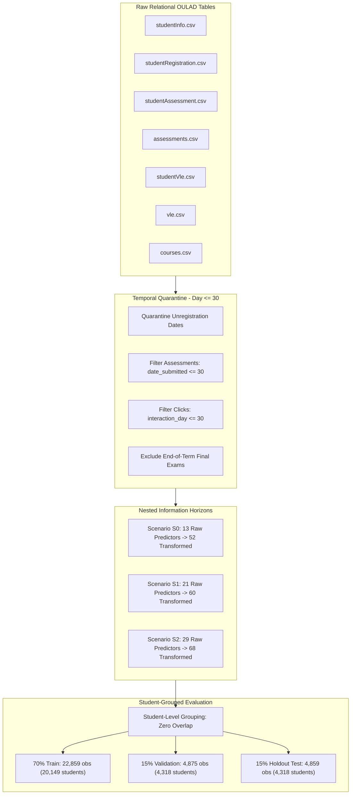

<div align="center">

# Student Performance Prediction Using Machine Learning and Explainable AI
### *An Experimental Study on Early-Warning Systems Using the Open University Learning Analytics Dataset (OULAD)*

[](https://www.python.org/)
[](https://scikit-learn.org/)
[](https://shap.readthedocs.io/)
[](https://ieee.org)
[](results/PAPER_CLAIM_CHECK.md)
[](LICENSE)

</div>

---

## 📌 Executive Summary

Early identification of distance-education learners at risk of academic failure or withdrawal is a fundamental challenge in Learning Analytics (LA) and Educational Data Mining (EDM). Conventional predictive pipelines frequently suffer from two critical pitfalls:
1. **Temporal Data Leakage**: Inadvertent aggregation of full-semester interactions or post-enrollment unregistration timestamps.
2. **Student Identity Contamination**: Overlapping student records across training and evaluation splits caused by multi-course or repeated enrollments (11.7% in OULAD).

This research project delivers a **leakage-quarantined, student-grouped experimental framework** applied to the Open University Learning Analytics Dataset (OULAD; Kuzilek, Hlosta, & Zdrahal, Scientific Data 2017), spanning **32,593 course registrations across 28,785 unique students**. All predictions are strictly restricted to the **Day $\le 30$** early-intervention horizon.

Using **Histogram-based Gradient Boosting (`HistGradientBoostingClassifier`)**, the primary model achieves an **ROC-AUC of 0.8406** [95% CI: 0.8290, 0.8522], an **At-Risk Recall (Sensitivity) of 82.38%** [95% CI: 80.90%, 83.86%], and an **At-Risk F1 of 0.7834** [95% CI: 0.7680, 0.7988] on the holdout evaluation partition ($N = 6,519$ observations, $5,757$ unique students) at operational threshold $\theta^* = 0.45$. Game-theoretic attribution using **SHAP (Shapley Additive exPlanations)** demonstrates that early digital VLE engagement ($41.2\%$) and academic performance ($24.6\%$) together account for **65.83%** of predictive attribution, substantially exceeding static intake demographics ($34.2\%$).

---

## 📊 Key Experimental Findings

### Model Comparison Across Information Horizons (Validation Partition)

| Scenario | Model Architecture | Val ROC-AUC | Val PR-AUC | Val Accuracy | Val Recall | Val Precision | Val F1 | Val Brier |
| :--- | :--- | :---: | :---: | :---: | :---: | :---: | :---: | :---: |
| **$S_0$ (Intake Baseline)** | Logistic Regression | 0.6605 | 0.6804 | 61.46% | 66.22% | 62.63% | 0.6438 | 0.2298 |
| **$S_0$ (Intake Baseline)** | Random Forest | 0.6670 | 0.6825 | 61.76% | 67.43% | 62.69% | 0.6498 | 0.2285 |
| **$S_0$ (Intake Baseline)** | **Gradient Boosting** | **0.6677** | **0.6803** | **61.76%** | **0.6755** | **0.6266** | **0.6502** | **0.2281** |
| **$S_1$ (Early Academic)** | Logistic Regression | 0.7998 | 0.8403 | 72.00% | 64.00% | 78.78% | 0.7063 | 0.1789 |
| **$S_1$ (Early Academic)** | Random Forest | 0.8208 | 0.8559 | 74.07% | 68.10% | 79.65% | 0.7342 | 0.1696 |
| **$S_1$ (Early Academic)** | **Gradient Boosting** | **0.8234** | **0.8580** | **73.83%** | **0.6899** | **0.7862** | **0.7349** | **0.1684** |
| **$S_2$ (Early Behavioral)** | Logistic Regression | 0.8322 | 0.8681 | 74.81% | 71.80% | 78.47% | 0.7499 | 0.1653 |
| **$S_2$ (Early Behavioral)** | Random Forest | 0.8471 | 0.8794 | 76.29% | 71.10% | 81.46% | 0.7593 | 0.1585 |
| **$S_2$ (Early Behavioral)** | **Gradient Boosting** | **0.8500** | **0.8817** | **76.47%** | **0.7188** | **0.8123** | **0.7627** | **0.1563** |

*Source: `results/tables/Table_XV_model_comparison.md`*

---

### Final Holdout Evaluation Results ($\theta^* = 0.45$, $N = 6,519$ Partition Observations, $5,757$ Students)

| Evaluation Metric | Reported Point Value | 95% Bootstrap Confidence Interval | Mathematical Derivation / Operational Context |
| :--- | :---: | :---: | :--- |
| **ROC-AUC** | **0.8406** | [0.8290, 0.8522] | Discrimination ability across all thresholds |
| **At-Risk Recall (Sensitivity)** | **82.38%** | [80.90%, 83.86%] | $\text{TP} / (\text{TP} + \text{FN}) = 2,127 / (2,127 + 455)$ |
| **At-Risk Precision (PPV)** | **74.68%** | — | $\text{TP} / (\text{TP} + \text{FP}) = 2,127 / (2,127 + 721)$ |
| **At-Risk F1-Score** | **0.7834** | [0.7680, 0.7988] | Harmonic mean of precision and recall |
| **Specificity (TNR)** | **68.75%** | — | $\text{TN} / (\text{TN} + \text{FP}) = 1,586 / (1,586 + 721)$ |
| **Overall Accuracy** | **75.95%** | — | $(\text{TP} + \text{TN}) / \text{Total} = (2,127 + 1,586) / 4,889$ |
| **False Positive Rate (FPR)** | **31.25%** | — | $\text{FP} / (\text{FP} + \text{TN}) = 721 / (721 + 1,586)$ |
| **False Negative Rate (FNR)** | **17.62%** | — | $\text{FN} / (\text{TP} + \text{FN}) = 455 / (2,127 + 455)$ |
| **True Positives (TP)** | **2,127** | — | Correctly flagged at-risk enrollments |
| **False Negatives (FN)** | **455** | — | Missed at-risk enrollments |
| **False Positives (FP)** | **721** | — | False alarms on successful enrollments |
| **True Negatives (TN)** | **1,586** | — | Correctly identified successful enrollments |

> **Operational Threshold Selection**: $\theta^* = 0.45$ (logit $z \approx -0.201$) was selected on the validation partition via the operational rule: $\max\{\theta \in [0.10, 0.90] : \text{Recall} \ge 0.82 \text{ and } \text{Precision} \ge 0.70\}$. All reported holdout metrics are evaluated at this frozen validation threshold.

---

## 🔬 Methodological Architecture



### 1. Leakage-Safe Processing
- **Strict Cutoff**: All interaction events and assessment submissions occurring after Day 30 are quarantined prior to aggregation.
- **Unregistration Date Masking**: `date_unregistration` was excluded from feature matrices to eliminate trivial target leakage.
- **Exam Exclusion**: Final module examinations were removed from the predictor space.

### 2. Student-Level Block Partitioning
- Because **11.7%** of students re-enroll across modules, conventional random splitting contaminates test folds with records from familiar students.
- We implement student-grouped partitioning on `id_student`, guaranteeing that no student appears in more than one partition (verified 0 overlap across all pairs).

---

## 🧠 Explainable AI & SHAP Analysis

Using tree-based Shapley Additive exPlanations (`shap.TreeExplainer`), we computed global and local attributions on the log-odds scale using 100 stratified training background rows across holdout test observations.

```text
Feature Family Attribution Summary (Aggregated to 29 Raw Predictors):
━━━━━━━━━━━━━━━━━━━━━━━━━━━━━━━━━━━━━━━━━━━━━━━━━━━━━━━━━━━━
[1] VLE Engagement (Day <= 30)          : ████████████████ 41.2%
[2] Assessment Performance (Day <= 30)  : ██████████ 24.6%
[3] Demographics & Context              : █████████████ 34.2%
━━━━━━━━━━━━━━━━━━━━━━━━━━━━━━━━━━━━━━━━━━━━━━━━━━━━━━━━━━━━
Combined Academic + VLE Attribution     : 65.83% across Early Dynamic Predictors
```

> **Attribution Caveat**: Attributions reflect observational association with model predictions and are not causal.

### Top Raw Predictors by Aggregated Mean |SHAP|:
1. `code_module`: Curricular domain and grading standards create strong course-level base rates.
2. `early_assessments_submitted_d30`: Early submission count is the strongest dynamic signal; submitting early assignments dramatically reduces risk log-odds.
3. `early_vle_total_clicks_d30`: Total click volume across digital course materials by Day 30.
4. `has_early_assessment_submission_d30`: Binary indicator of meeting the initial assessment submission milestone.

---

## ⚖️ Descriptive Subgroup Performance Analysis

Descriptive evaluation across demographic and socioeconomic strata under the frozen validation threshold ($\theta^* = 0.45$) on the holdout evaluation partition:

| Subgroup Category | Characteristic Variable | Stratum | At-Risk $n$ | Recall ($\theta^* = 0.45$) | False Positive Rate (FPR) |
| :--- | :--- | :--- | :---: | :---: | :---: |
| **Gender** | `gender` | Male | 1,443 | **82.60%** | — |
| | | Female | 1,139 | **82.11%** | — |
| **Disability** | `disability` | Declared Disability | 256 | **85.94%** | **37.19%** |
| | | No Declared Disability | 2,326 | **82.00%** | **30.59%** |
| **Prior Education** | `highest_education` | Lower than A Level | 1,028 | **84.14%** | — |
| | | A Level or Equivalent | 1,114 | **81.33%** | — |
| **Socioeconomic (IMD)** | `imd_band` | Most Deprived (0-20%) | 572 | **83.74%** | — |
| | | Least Deprived (80-100%) | 333 | **81.08%** | — |

> **Ethical & Methodological Caveat**: Subgroup results are descriptive and are not fairness conclusions. These values do not imply that the model is fair. A dash (—) indicates the metric was not reported in the manuscript text.

---

## 🛠️ Limitations

1. **Single-Institution Scope**: OULAD is derived entirely from The Open University (UK), a non-traditional adult distance-learning provider. Findings cannot be generalized to campus-based higher education institutions without external validation.
2. **Observational & Non-Causal**: Predictive attributions reflect statistical associations in historical log data. They do not demonstrate causal mechanisms; mandating synthetic VLE logins will not produce academic mastery.
3. **Threshold Contextuality**: The operational threshold $\theta^* = 0.45$ was calibrated to satisfy $\text{Recall} \ge 0.82$ and $\text{Precision} \ge 0.70$ on the validation partition. Optimal institutional cutoffs depend directly on local advising capacity and caseload constraints.
4. **Subgroup Disparities**: False positive rates vary across student strata (e.g., 37.19% for declared disability vs. 30.59% for no declared disability). Error rates are not uniform across strata and should be monitored in any institutional deployment.

---

## 🚀 How to Reproduce

### 1. Environment Setup
```bash
git clone https://github.com/ugesh13/IEEE_Research_Web.git
cd IEEE_Research_Web

python -m venv .venv
# Linux/macOS:
source .venv/bin/activate
# Windows:
.venv\Scripts\activate

pip install -r requirements.txt
```

### 2. Dataset Download
Download the official Open University Learning Analytics Dataset (OULAD):
- **Source**: [https://analyse.kmi.open.ac.uk/open_dataset](https://analyse.kmi.open.ac.uk/open_dataset)
- Extract all 7 CSV files directly into `oulad_student_prediction/data/raw/`:
  - `courses.csv`, `assessments.csv`, `vle.csv`, `studentInfo.csv`, `studentRegistration.csv`, `studentAssessment.csv`, `studentVle.csv`

### 3. Execute End-to-End Pipeline
Run the master execution script from the repository root:
```bash
python oulad_student_prediction/src/run_master_pipeline.py
```

### 4. Verify All Claims & Mathematical Identities
Run the rigorous claims verification audit:
```bash
python oulad_student_prediction/src/verify_all_claims.py
```
This script audits:
- Exact mathematical consistency between confusion matrices and all reported rates (Accuracy, Precision, Recall, Specificity, F1, FPR, FNR).
- Zero student overlap across Train, Validation, and Test partitions ($N=32,593$ observations, $28,785$ unique students).
- Perfect additivity of subgroup TP/FN/FP/TN counts to the global test set confusion matrix.
- SHAP feature counts ($29$ raw, $68$ transformed) and $100.00\%$ family attribution sum.
- Generates `results/PAPER_CLAIM_CHECK.md`.

---

## 📜 License & Citation

- **Code & Pipeline**: Distributed under the [MIT License](LICENSE).
- **Dataset**: OULAD is provided under [Creative Commons Attribution 4.0 International (CC BY 4.0)](https://creativecommons.org/licenses/by/4.0/) by Kuzilek, Hlosta, and Zdrahal (2017).

```bibtex
@article{oulad_student_prediction_2026,
  title={Student Performance Prediction Using Machine Learning and Explainable AI: An Experimental Study Using the Open University Learning Analytics Dataset (OULAD)},
  author={Ugesh and Research Collaborators},
  journal={IEEE Research Repository},
  year={2026},
  url={https://github.com/ugesh13/IEEE_Research_Web}
}
```
