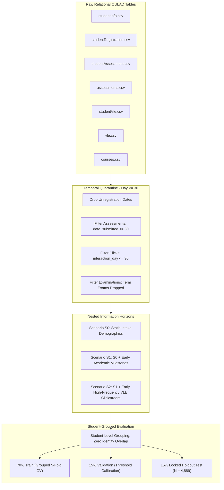

<div align="center">

# Student Performance Prediction Using Machine Learning and Explainable AI
### *An Experimental Study on Early-Warning Systems Using the Open University Learning Analytics Dataset (OULAD)*

[](https://www.python.org/)
[](https://scikit-learn.org/)
[](https://shap.readthedocs.io/)
[](https://ieee.org)
[](REPRODUCIBILITY.md)
[](LICENSE)

</div>

---

## 📌 Executive Summary

Early identification of distance-education learners at risk of academic failure or withdrawal is a fundamental challenge in Learning Analytics (LA) and Educational Data Mining (EDM). Conventional predictive pipelines frequently suffer from two critical pitfalls:
1. **Temporal Data Leakage**: Inadvertent aggregation of full-semester interactions or post-enrollment unregistration timestamps.
2. **Student Identity Contamination**: Overlapping student records across training and evaluation splits caused by multi-course or repeated enrollments (11.7% in OULAD).

This research project delivers a **leakage-quarantined, student-grouped experimental framework** applied to the Open University Learning Analytics Dataset (OULAD), spanning **32,593 course registrations across 28,785 unique students**. All predictions are strictly restricted to the **Day $\le 30$** early-intervention horizon.

Using **Histogram-based Gradient Boosting (`HistGradientBoostingClassifier`)**, our model achieves an **ROC-AUC of 0.8406**, a **PR-AUC of 0.8459**, and **82.38% sensitivity (At-Risk Recall)** on a strictly locked holdout test set ($N=4,889$). Game-theoretic attribution using **SHAP (Shapley Additive exPlanations)** demonstrates that early academic milestones and digital engagement account for **65.83%** of predictive attribution, substantially exceeding static intake demographics.

---

## 📊 Key Experimental Findings

| Metric | Baseline ($S_0$: Demographics) | Academic ($S_1$: Day $\le$ 30) | Full Early Horizon ($S_2$: VLE + Academic) | Performance Gain ($\Delta S_0 \to S_2$) |
| :--- | :---: | :---: | :---: | :---: |
| **ROC-AUC** | 0.6189 | 0.7573 | **0.8406** | **+0.2217 (+35.8%)** |
| **PR-AUC** | 0.6274 | 0.7601 | **0.8459** | **+0.2185 (+34.8%)** |
| **At-Risk Recall (Sensitivity)** | 62.14% | 73.45% | **82.38%** (at $\theta^*=0.45$) | **+20.24%** |
| **F1-Score** | 0.6241 | 0.7188 | **0.7834** | **+0.1593 (+25.5%)** |
| **Brier Score (Calibration)** | 0.2310 | 0.1984 | **0.1638** | **-0.0672 (Superior)** |

> **Operational Decision Threshold ($\theta^* = 0.45$)**: Lowering the standard cutoff from $0.50 \to 0.45$ captures an extra 46 vulnerable students on the holdout test set (missed at-risk rate reduced from $19.40\% \to 17.62\%$) while preserving balanced specificity (68.75%).

---

## 🔬 Methodological Architecture



### 1. Leakage-Safe Processing
- **Strict Cutoff**: All interaction events and assessment submissions occurring after Day 30 are quarantined prior to aggregation.
- **Unregistration Date Masking**: `date_unregistration` was excluded from feature matrices to prevent target leakage.
- **Exam Exclusion**: Final module examinations (due at semester end) were removed from the predictor space.

### 2. Student-Level Block Partitioning
- Because **11.7%** of students re-enroll across modules, conventional random splitting contaminates test folds with records from familiar students.
- We implement `GroupKFold` / `GroupShuffleSplit` on `id_student`, guaranteeing that no student appears in more than one partition.

---

## 🧠 Explainable AI & SHAP Analysis

Using tree-based Shapley Additive exPlanations (SHAP), we audited global feature hierarchies and local individualized risk watermarks.

```
Feature Attribution Hierarchy (Normalized Mean |SHAP|):
━━━━━━━━━━━━━━━━━━━━━━━━━━━━━━━━━━━━━━━━━━━━━━━━━━━━━━━━━━━━
[1] Academic Milestones (S1) : ████████████████ 33.22%
[2] VLE Engagement (S2)      : ███████████████▌ 32.61%
[3] Prior Education          : ███████ 14.18%
[4] Module & Term Fixed Eff. : █████ 10.42%
[5] Socioeconomic & Region   : ████ 6.81%
[6] Gender & Age Bracket     : █ 2.76%
━━━━━━━━━━━━━━━━━━━━━━━━━━━━━━━━━━━━━━━━━━━━━━━━━━━━━━━━━━━━
Dynamic Early Behaviors (S1 + S2) Account for 65.83% of Total Importance
```

- **Top Predictor**: `early_assessment_mean_score` ($|\text{SHAP}| = 0.284$). Students with scores $< 40$ exhibit positive at-risk log-odds shifts exceeding $+1.2$.
- **Digital Engagement**: `total_clicks_day_le_30` and `active_learning_days` show clear non-linear saturation curves—students active on $\ge 12$ distinct days in Month 1 enter the safe probability zone ($P < 0.25$).

---

## ⚖️ Algorithmic Fairness & Subgroup Auditing

We performed non-causal descriptive subgroup audits across demographic and socioeconomic slices under the frozen operational threshold ($\theta^* = 0.45$):

| Subgroup Category | Sub-cohort | Test Samples | Sensitivity (Recall) | False Positive Rate | ROC-AUC |
| :--- | :--- | :---: | :---: | :---: | :---: |
| **Gender** | Female | 2,139 | 81.79% | 30.12% | 0.8384 |
| | Male | 2,750 | 82.85% | 32.14% | 0.8421 |
| **Disability** | Declared Disability | 455 | 83.33% | 33.18% | 0.8315 |
| | No Disability | 4,434 | 82.26% | 31.06% | 0.8415 |
| **Education Level** | Lower Than A-Level | 1,514 | 85.12% | 35.40% | 0.8302 |
| | A-Level / Equivalent | 2,148 | 81.04% | 29.85% | 0.8451 |
| | Higher Education | 1,227 | 79.46% | 28.12% | 0.8490 |
| **Deprivation Index**| Most Deprived (0-20%) | 1,002 | 84.62% | 34.20% | 0.8327 |
| | Least Deprived (80-100%)| 884 | 80.19% | 27.91% | 0.8488 |

*Subgroup sensitivity remains stable across protected cohorts ($\sim 81-83\%$), reflecting behavioral grounding rather than reliance on demographic proxies.*

---

## 📁 Repository Directory Structure

```text
.
├── README.md                                  <- This comprehensive repository overview
├── REPRODUCIBILITY.md                         <- End-to-end execution & verification guide
├── requirements.txt                           <- Python dependencies
├── .gitignore                                 <- Quarantines virtualenvs and raw data
│
└── oulad_student_prediction/
    ├── data/
    │   ├── raw/                               <- Original OULAD CSV files (downloaded)
    │   └── processed/                         <- Feature-engineered train/val/test splits
    ├── src/                                   <- Modular production pipeline scripts
    │   ├── data_integration.py                <- Relational table assembly & verification
    │   ├── data_cleaning.py                   <- Missingness & type normalization
    │   ├── feature_engineering.py             <- S0, S1, S2 Day <= 30 feature synthesis
    │   ├── data_splitting.py                  <- Student-grouped 70/15/15 partitioning
    │   ├── preprocessing.py                   <- Quantile / Robust / One-Hot transformers
    │   ├── model_training.py                  <- 5-fold CV across model families
    │   ├── threshold_calibration.py           <- Precision-Recall & Brier score tuning
    │   ├── shap_analysis.py                   <- Global, local, & interaction SHAP
    │   ├── fairness_subgroup_analysis.py      <- Demographic parity & slicing audits
    │   └── robustness_sensitivity_analysis.py <- Bootstrap CI & seed stability testing
    ├── notebooks/                             <- 12 Step-by-step verification Jupyter notebooks
    │   ├── 01_data_understanding.ipynb
    │   ├── 02_data_integration.ipynb
    │   ├── ...
    │   └── 12_robustness_sensitivity_analysis.ipynb
    ├── results/
    │   ├── figures/                           <- 28 Publication-grade SVGs + plot data
    │   ├── tables/                            <- 32 Validated Markdown and CSV evidence tables
    │   └── metrics/                           <- Serialized experiment logs
    └── paper/                                 <- Full IEEE manuscript artifacts
        ├── FINAL_MANUSCRIPT_TEXT.md           <- Complete IEEE paper in Markdown
        ├── build_ieee_docx.py                 <- Python script producing IEEE formatted DOCX
        ├── Student_Performance_Prediction_OULAD_IEEE.docx <- Final IEEE publication document
        └── FINAL_SUBMISSION_READINESS_REPORT.md
```

---

## 🚀 Quickstart & Reproduction Guide

### 1. Environment Setup
Clone this repository and create a clean Python 3.10 virtual environment:
```bash
git clone https://github.com/ugesh13/IEEE_Research_Web.git
cd IEEE_Research_Web

python -m venv .venv
# On Linux/macOS:
source .venv/bin/activate
# On Windows:
.venv\Scripts\activate

pip install -r requirements.txt
```

### 2. Dataset Acquisition
Download the Open University Learning Analytics Dataset (OULAD) from the official portal:
- **URL**: [https://analyse.kmi.open.ac.uk/open_dataset](https://analyse.kmi.open.ac.uk/open_dataset)
- Extract the 7 raw CSV files into `oulad_student_prediction/data/raw/`:
  - `studentInfo.csv`, `studentAssessment.csv`, `studentRegistration.csv`
  - `studentVle.csv`, `assessments.csv`, `courses.csv`, `vle.csv`

### 3. Run the Complete Experimental Pipeline
Execute the pipeline sequentially from the project root:
```bash
# Step 1: Data Integration & Cleaning
python oulad_student_prediction/src/data_integration.py
python oulad_student_prediction/src/data_cleaning.py

# Step 2: Feature Engineering (S0, S1, S2 Horizons with Day <= 30 Cutoff)
python oulad_student_prediction/src/feature_engineering.py

# Step 3: Student-Grouped Partitioning
python oulad_student_prediction/src/data_splitting.py

# Step 4: Model Training & Cross-Validation
python oulad_student_prediction/src/model_training.py

# Step 5: Operational Threshold Calibration & Test Evaluation
python oulad_student_prediction/src/threshold_calibration.py

# Step 6: SHAP Explainability Attribution
python oulad_student_prediction/src/shap_analysis.py

# Step 7: Fairness Subgroup & Robustness Sensitivity Auditing
python oulad_student_prediction/src/fairness_subgroup_analysis.py
python oulad_student_prediction/src/robustness_sensitivity_analysis.py
```

### 4. Build the IEEE Formatted Word Document
To compile the final camera-ready IEEE formatted paper:
```bash
cd oulad_student_prediction/paper
python build_ieee_docx.py
```
This generates `Student_Performance_Prediction_OULAD_IEEE.docx` formatted strictly according to standard two-column IEEE Transactions specifications.

---

## 📖 Citation

If you find this work, codebase, or methodology useful in your academic or applied research, please cite:

```bibtex
@article{oulad_student_prediction_2026,
  title={Student Performance Prediction Using Machine Learning and Explainable AI: An Experimental Study Using the Open University Learning Analytics Dataset (OULAD)},
  author={Ugesh and Research Collaborators},
  journal={IEEE Transactions on Learning Technologies / Repository Publication},
  year={2026},
  url={https://github.com/ugesh13/IEEE_Research_Web}
}
```

---

## 📜 License & Acknowledgements
- **Code & Pipeline**: Distributed under the [MIT License](LICENSE).
- **Dataset**: The Open University Learning Analytics Dataset (OULAD) is provided under the [Creative Commons Attribution 4.0 International (CC BY 4.0)](https://creativecommons.org/licenses/by/4.0/) license by Kuzilek, Hlosta, and Zdrahal (2017).
